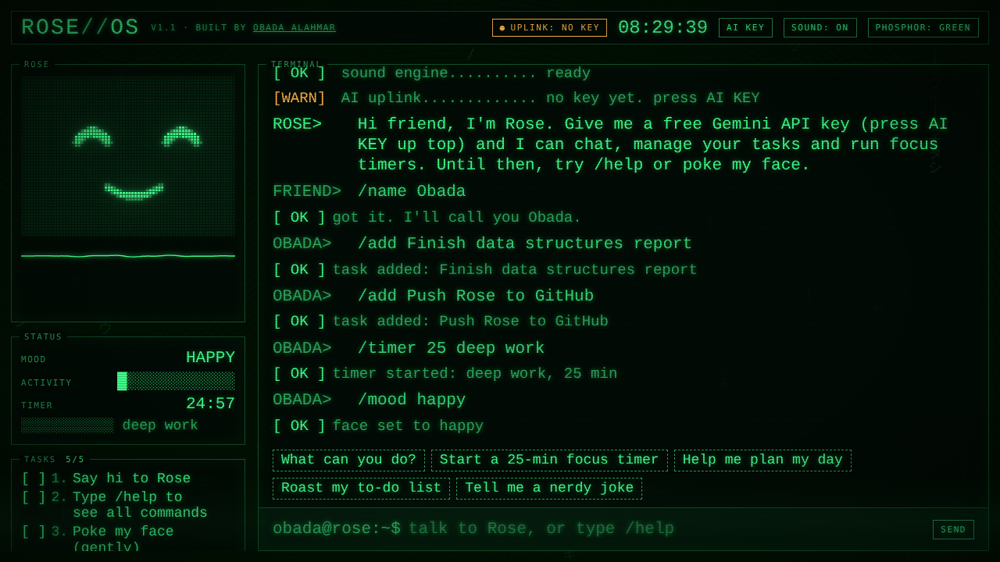

# Rose Terminal

A retro terminal AI assistant with a face that's actually alive. Rose blinks, follows your cursor, changes expression with every reply, gets bored when you ignore her, and falls asleep if you leave her alone long enough. Her brain is Google Gemini (free tier).



**Live demo:** https://osi27i.github.io/rose-terminal/ *(update this link after you deploy)*

## What she can do

- **Chat** through the Gemini API, with a Jarvis-style personality (short, honest, a bit cheeky)
- **Manage a task list.** Say "add a task to finish my report" or "mark task 2 done" and she does it with Gemini function calling
- **Run focus timers.** "Start a 50 minute timer for revision", and she beeps and celebrates when it ends
- **Change her own colour.** Green, amber or cyan phosphor, if you ask nicely

## The "alive" part

- **LED face (72x54 pixels)** drawn on a canvas. Each frame is rendered at low resolution, thresholded and redrawn as glowing LED dots
- **10 moods** (happy, smug, thinking, annoyed, sleepy...). The model starts every reply with a mood tag like `[smug]` and the face animates to it
- Eyes **follow the mouse**, look at the input box while you type, and wander around when you're idle
- **Mouth moves while she "talks"** (the typewriter output), and an oscilloscope line reacts to it
- **Digital rain background** that glows near your cursor, with pulse rings when she speaks
- **Sound effects generated with the Web Audio API.** No audio files: keyboard clicks, typing ticks, boops and alarms are all synthesized
- **Idle behaviour:** random thoughts after 15s, sleep mode with floating "zzz" after 60s. Click her face to poke her (don't overdo it)

## Run it

It's one HTML file with no build step and no dependencies.

1. Get a free Gemini API key at [aistudio.google.com/apikey](https://aistudio.google.com/apikey)
2. Open `index.html` in a browser (or the live demo)
3. Press **AI KEY**, paste the key and hit **Test and save**. Rose picks the newest free Flash model for you

The key is saved in your browser's localStorage and is only sent to Google. It never touches this repo.

> Note: on Gemini's free tier, Google may use your chats to improve its products, and there's a daily request limit. Don't paste anything private.

## Commands

| Command | What it does |
|---|---|
| `/help` | list all commands |
| `/add <task>` / `/done <n>` / `/del <n>` | manage tasks without the AI |
| `/timer <min> [label]` / `/stop` | focus timer |
| `/theme green\|amber\|cyan` | phosphor colour |
| `/mood <mood>` | force a face (good for showing off) |
| `/name <name>` | what Rose calls you |
| `/key` | set API key and model |
| `/clear`, `/reset` | clear chat / wipe all saved data |

`Esc` stops a reply mid-way, and `↑`/`↓` scroll through what you sent before.

## Deploy to GitHub Pages

1. Push this repo to GitHub
2. Go to **Settings → Pages → Deploy from a branch → `main` / root**
3. Your site will be at `https://<username>.github.io/<repo-name>/`

## Public demo (optional): let people chat without their own key

**Never put your API key in `index.html`.** Anyone can read it from a public repo or the browser.

Instead, `worker/worker.js` is a small Cloudflare Worker (free plan) that holds the key as a secret and forwards requests to Gemini. Setup steps are at the top of that file. After deploying, put the Worker URL in `CONFIG.PROXY_URL` at the top of the script in `index.html`.

The Worker only allows Flash models and your GitHub Pages origin. Keep billing **off** on that Google project, so the worst that can happen is hitting the free daily limit.

## How it's built

- Vanilla HTML, CSS and JavaScript in a single file
- Canvas 2D for the LED face, oscilloscope and rain
- Gemini REST API (`generateContent`) with function calling for tasks, timer and theme
- Web Audio API for every sound
- localStorage for tasks, chat history and settings
- Honours `prefers-reduced-motion`, has keyboard-focus styles and works on phones

## Project structure

```
index.html        the whole app
worker/worker.js  optional proxy for a public demo
docs/             screenshots
```

## Author

Built by **Obada Alahmar**, Computer Science (AI) student at Asia Pacific University, Malaysia.
[GitHub](https://github.com/osi27I) · [LinkedIn](https://www.linkedin.com/in/obada-alahmar-98a047373)

MIT License
